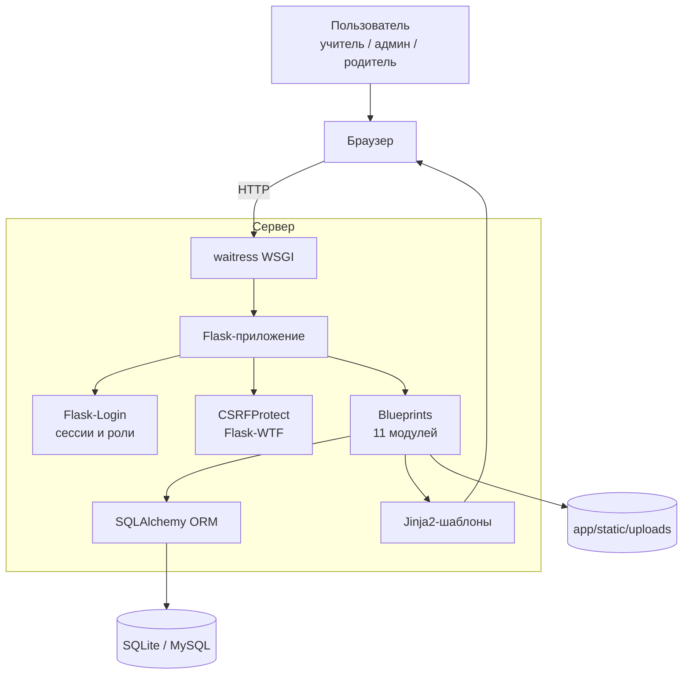
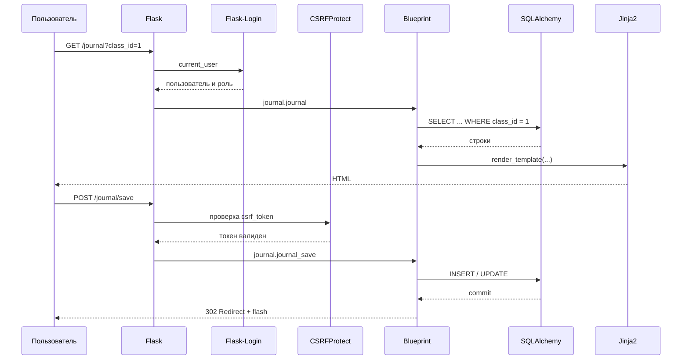

# Архитектура системы

## 1. Назначение

«Система-помощник учителя музыки в школе» — веб-приложение для автоматизации
работы учителя музыки: классы и ученики, расписание, репертуар, планы-конспекты,
материалы к урокам, журнал посещаемости и оценок, мероприятия и отчёты.

## 2. Технологический стек

| Уровень | Технология | Назначение |
|---------|------------|------------|
| Язык | Python 3.10+ | серверная логика |
| Веб-фреймворк | Flask 3.0 | маршрутизация, шаблоны, сессии |
| ORM | SQLAlchemy 2.x (Flask-SQLAlchemy) | работа с БД через модели |
| БД | SQLite (по умолчанию), MySQL (опционально) | хранение данных |
| Аутентификация | Flask-Login | вход, сессии, роли |
| Формы и CSRF | Flask-WTF / WTForms | защита POST-запросов |
| Шаблоны | Jinja2 | генерация HTML |
| Frontend | Bootstrap 5, Bootstrap Icons, Manrope | адаптивный интерфейс |
| Файлы | локальная папка `app/static/uploads` | материалы к урокам |
| WSGI-сервер | waitress | production-запуск |
| Тесты | pytest | автоматическая проверка |

## 3. Архитектура приложения



### Слои

1. **Представление** — Jinja2-шаблоны и статические файлы (CSS, JS).
   Bootstrap 5 отвечает за сетку и компоненты, собственный `style.css` —
   за тёмную и светлую темы.
2. **Маршруты (controllers)** — 11 blueprints в `app/routes/`. Каждый модуль
   отвечает за свой раздел: список, создание, редактирование, удаление.
3. **Бизнес-правила** — декораторы `app/utils/decorators.py`
   (`admin_required`, `staff_required`) и правила доступа к классам
   `app/utils/access.py`.
4. **Модель данных** — SQLAlchemy-модели в `app/models.py`.
5. **Хранилище** — SQLite-файл `instance/music_assistant.db` и папка загрузок.

## 4. Структура проекта

```text
app/
├── __init__.py          # фабрика create_app(), инициализация расширений
├── models.py            # 11 моделей данных
├── seed.py              # демонстрационные данные
├── routes/
│   ├── auth.py          # вход, выход, пользователи
│   ├── main.py          # главная / личный кабинет родителя
│   ├── students.py      # классы и ученики
│   ├── schedule.py      # расписание
│   ├── repertoire.py    # репертуар
│   ├── lesson_plans.py  # планы-конспекты
│   ├── materials.py     # материалы и файлы
│   ├── journal.py       # посещаемость и оценки
│   ├── reports.py       # отчёты и CSV
│   ├── events.py        # мероприятия
│   └── search.py        # глобальный поиск
├── templates/           # Jinja2-шаблоны
├── static/
│   ├── css/style.css    # тёмная и светлая темы
│   ├── js/main.js       # тема, сайдбар, уведомления
│   └── uploads/         # загруженные файлы
└── utils/
    ├── decorators.py    # проверка ролей
    └── access.py        # доступ родителя к классам
```

## 5. Жизненный цикл запроса



## 6. Принятые решения

- **Blueprints** — модульность: каждый раздел можно развивать независимо.
- **Фабрика приложения** `create_app()` — удобно создавать отдельные экземпляры
  для тестов с временной БД.
- **SQLite по умолчанию** — не требует установки СУБД, удобно для школы и защиты.
  Переход на MySQL выполняется сменой `DATABASE_URL`, код не меняется.
- **Роли на уровне маршрутов** — запрет проверяется до выполнения запроса,
  а не только скрытием кнопок в интерфейсе.
- **CSRF для всех POST-форм** — защита от подделки запросов.
- **waitress** — production-сервер для Windows без внешних зависимостей.
