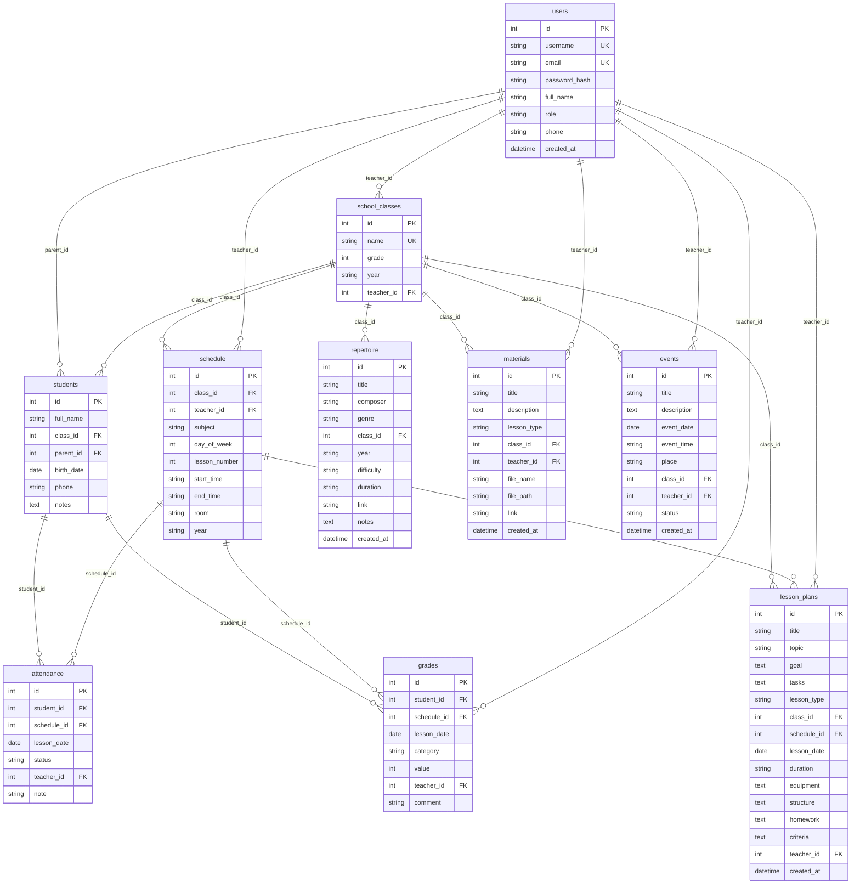

# База данных

## 1. СУБД

- По умолчанию — **SQLite** (`instance/music_assistant.db`), файл создаётся
  автоматически при первом запуске.
- Опционально — **MySQL** (`mysql+pymysql://...`), драйвер `PyMySQL` включён
  в `requirements.txt`.
- Схема создаётся через SQLAlchemy (`db.create_all()`), поэтому не зависит
  от конкретной СУБД.

## 2. ER-диаграмма

## 3. Описание таблиц

### `users` — пользователи

| Поле | Тип | Ограничения | Описание |
|------|-----|-------------|----------|
| id | INTEGER | PK | идентификатор |
| username | VARCHAR(64) | UNIQUE, NOT NULL, INDEX | логин |
| email | VARCHAR(120) | UNIQUE, NOT NULL, INDEX | электронная почта |
| password_hash | VARCHAR(256) | NOT NULL | хеш пароля (Werkzeug) |
| full_name | VARCHAR(120) | NOT NULL | ФИО |
| role | VARCHAR(20) | NOT NULL | `admin`, `teacher`, `parent` |
| phone | VARCHAR(32) | | телефон |
| created_at | DATETIME | | дата создания |

### `school_classes` — классы

| Поле | Тип | Ограничения | Описание |
|------|-----|-------------|----------|
| id | INTEGER | PK | идентификатор |
| name | VARCHAR(32) | UNIQUE, NOT NULL | название (`1А`, `7Б`) |
| grade | INTEGER | NOT NULL | параллель |
| year | VARCHAR(16) | NOT NULL | учебный год |
| teacher_id | INTEGER | FK → users.id | классный руководитель / учитель музыки |

### `students` — ученики

| Поле | Тип | Ограничения | Описание |
|------|-----|-------------|----------|
| id | INTEGER | PK | идентификатор |
| full_name | VARCHAR(120) | NOT NULL | ФИО |
| class_id | INTEGER | FK → school_classes.id, NOT NULL | класс |
| parent_id | INTEGER | FK → users.id | родитель |
| birth_date | DATE | | дата рождения |
| phone | VARCHAR(32) | | телефон |
| notes | TEXT | | заметки |

### `schedule` — расписание

| Поле | Тип | Описание |
|------|-----|----------|
| id | INTEGER | PK |
| class_id | INTEGER | FK → school_classes.id |
| teacher_id | INTEGER | FK → users.id |
| subject | VARCHAR(64) | предмет (по умолчанию «Музыка») |
| day_of_week | INTEGER | 1 — понедельник … 7 — воскресенье |
| lesson_number | INTEGER | номер урока |
| start_time / end_time | VARCHAR(5) | время `ЧЧ:ММ` |
| room | VARCHAR(32) | кабинет |
| year | VARCHAR(16) | учебный год |

### `repertoire` — репертуар

| Поле | Тип | Описание |
|------|-----|----------|
| id | INTEGER | PK |
| title | VARCHAR(180) | название произведения |
| composer | VARCHAR(180) | композитор |
| genre | VARCHAR(64) | жанр |
| class_id | INTEGER | FK → school_classes.id (NULL — общий репертуар) |
| year | VARCHAR(16) | учебный год |
| difficulty | VARCHAR(16) | сложность |
| duration | VARCHAR(16) | длительность |
| link | VARCHAR(300) | ссылка на аудио/видео |
| notes | TEXT | заметки |

### `materials` — материалы к урокам

| Поле | Тип | Описание |
|------|-----|----------|
| id | INTEGER | PK |
| title | VARCHAR(180) | название |
| description | TEXT | описание |
| lesson_type | VARCHAR(32) | тип занятия |
| class_id | INTEGER | FK → school_classes.id (NULL — все классы) |
| teacher_id | INTEGER | FK → users.id |
| file_name | VARCHAR(255) | исходное имя файла |
| file_path | VARCHAR(500) | путь в `uploads` |
| link | VARCHAR(500) | внешняя ссылка |
| created_at | DATETIME | дата загрузки |

### `events` — мероприятия

| Поле | Тип | Описание |
|------|-----|----------|
| id | INTEGER | PK |
| title | VARCHAR(180) | название |
| description | TEXT | описание |
| event_date | DATE | дата |
| event_time | VARCHAR(5) | время |
| place | VARCHAR(180) | место |
| class_id | INTEGER | FK → school_classes.id (NULL — все классы) |
| teacher_id | INTEGER | FK → users.id |
| status | VARCHAR(16) | `Запланировано`, `Проведено`, `Отменено` |

### `attendance` — посещаемость

| Поле | Тип | Описание |
|------|-----|----------|
| id | INTEGER | PK |
| student_id | INTEGER | FK → students.id |
| schedule_id | INTEGER | FK → schedule.id |
| lesson_date | DATE | дата урока |
| status | VARCHAR(16) | `present`, `absent`, `late`, `excused` |
| teacher_id | INTEGER | FK → users.id |
| note | VARCHAR(255) | примечание |

### `grades` — оценки

| Поле | Тип | Описание |
|------|-----|----------|
| id | INTEGER | PK |
| student_id | INTEGER | FK → students.id |
| schedule_id | INTEGER | FK → schedule.id |
| lesson_date | DATE | дата урока |
| category | VARCHAR(32) | вид работы |
| value | INTEGER | оценка 1–5 |
| teacher_id | INTEGER | FK → users.id |
| comment | VARCHAR(255) | комментарий |

### `lesson_plans` — планы-конспекты

| Поле | Тип | Описание |
|------|-----|----------|
| id | INTEGER | PK |
| title | VARCHAR(180) | тема урока |
| topic | VARCHAR(180) | раздел программы |
| goal | TEXT | цель |
| tasks | TEXT | задачи |
| lesson_type | VARCHAR(32) | тип урока |
| class_id | INTEGER | FK → school_classes.id |
| schedule_id | INTEGER | FK → schedule.id |
| lesson_date | DATE | дата |
| duration | VARCHAR(32) | длительность |
| equipment | TEXT | оборудование |
| structure | TEXT | ход урока |
| homework | TEXT | домашнее задание |
| criteria | TEXT | критерии оценивания |
| teacher_id | INTEGER | FK → users.id |

## 4. Связи

- **users → school_classes** (1:N) — учитель ведёт несколько классов.
- **users → students** (1:N) — у родителя несколько детей.
- **school_classes → students** (1:N) — в классе много учеников.
- **school_classes → schedule** (1:N) — у класса несколько уроков.
- **students → attendance / grades** (1:N) — журнал по ученику.
- **schedule → attendance / grades / lesson_plans** (1:N) — записи привязаны
  к конкретному уроку.
- **school_classes → repertoire / materials / events / lesson_plans** (1:N) —
  разделы могут быть привязаны к классу или быть общими (`NULL`).

## 5. Целостность

- Удаление класса каскадно удаляет его учеников
  (`cascade='all, delete-orphan'`).
- Внешние ключи SQLite по умолчанию не проверяются, но ORM не создаёт
  «висячих» ссылок при штатной работе.
- Уникальность логина, e-mail и названия класса проверяется на уровне БД
  и дополнительно в маршрутах (понятное сообщение пользователю).
