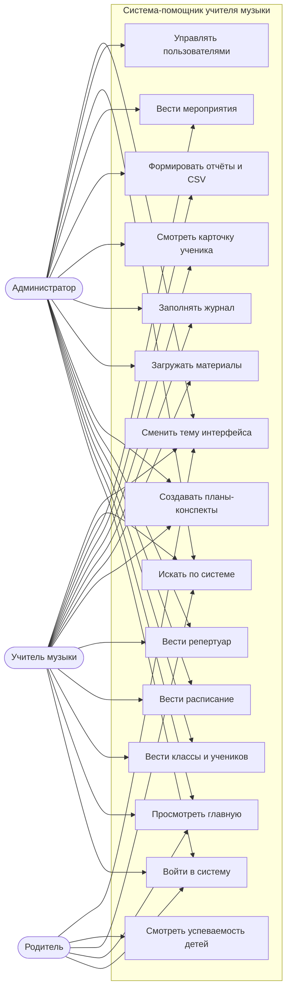

# Роли и сценарии использования

## 1. Акторы

| Актор | Описание | Основные задачи |
|-------|----------|-----------------|
| **Учитель музыки** | основной пользователь системы | ведёт классы, расписание, журнал, конспекты, материалы, отчёты |
| **Администратор** | завуч / администратор школы | управляет пользователями и ролями, имеет полный доступ |
| **Родитель** | законный представитель ученика | смотрит успеваемость и посещаемость своих детей |

## 2. Use-case-диаграмма

## 3. Матрица прав

| Возможность | Админ | Учитель | Родитель |
|-------------|:-----:|:-------:|:--------:|
| Вход и выход | ✓ | ✓ | ✓ |
| Главная страница | ✓ | ✓ | личный кабинет |
| Классы и ученики — просмотр | ✓ | ✓ | только свои классы |
| Классы и ученики — изменение | ✓ | ✓ | — |
| Расписание — просмотр | ✓ | ✓ | только свои классы |
| Расписание — изменение | ✓ | ✓ | — |
| Репертуар — просмотр | ✓ | ✓ | свой класс + общий |
| Репертуар — изменение | ✓ | ✓ | — |
| Планы-конспекты — просмотр | ✓ | ✓ | свой класс + общие |
| Планы-конспекты — изменение | ✓ | ✓ | — |
| Материалы — просмотр и скачивание | ✓ | ✓ | свой класс + общие |
| Материалы — загрузка и удаление | ✓ | ✓ | — |
| Журнал — просмотр | ✓ | ✓ | только свои дети |
| Журнал — заполнение | ✓ | ✓ | — |
| Отчёты и CSV | ✓ | ✓ | только свои дети |
| Мероприятия — просмотр | ✓ | ✓ | свой класс + общие |
| Мероприятия — изменение | ✓ | ✓ | — |
| Пользователи | ✓ | — | — |
| Глобальный поиск | ✓ | ✓ | только доступные данные |
| Смена темы | ✓ | ✓ | ✓ |

## 4. Основные сценарии

### UC-01. Вход в систему

1. Пользователь открывает `/login`.
2. Вводит логин (или e-mail) и пароль.
3. Система проверяет хеш пароля.
4. При успехе создаётся сессия и выполняется переход на главную.
5. При ошибке выводится сообщение «Неверный логин или пароль».

### UC-02. Добавление класса

1. Учитель открывает «Классы» → «Добавить класс».
2. Указывает название, параллель, учебный год и учителя.
3. Система проверяет уникальность названия.
4. Класс сохраняется и появляется в списке.

### UC-03. Добавление ученика

1. Учитель открывает карточку класса → «Добавить ученика».
2. Указывает ФИО, при необходимости — родителя, дату рождения, телефон.
3. Ученик сохраняется в выбранном классе.
4. Родитель, указанный в карточке, начинает видеть ученика в своём кабинете.

### UC-04. Проведение урока и заполнение журнала

1. Учитель открывает «Журнал», выбирает класс, дату и урок.
2. Отмечает посещаемость каждого ученика.
3. Выставляет оценки и вид работы.
4. Нажимает «Сохранить».
5. Система создаёт или обновляет записи без дубликатов.

### UC-05. Формирование отчёта

1. Учитель открывает «Отчёты».
2. Выбирает класс и период (весь год / месяц / четверть).
3. Система считает посещаемость, средний балл и распределение оценок.
4. Кнопка «Экспорт CSV» выгружает таблицу для Excel.

### UC-06. Просмотр успеваемости родителем

1. Родитель входит в систему.
2. На главной видит только своих детей, их классы, оценки и расписание.
3. В «Журнале» доступны только его дети.
4. В «Отчётах» — только классы его детей.
5. Попытка открыть чужой класс по прямому адресу возвращает ошибку 403.

### UC-07. Загрузка материала

1. Учитель открывает «Материалы» → «Добавить материал».
2. Указывает название, тип занятия, класс.
3. Прикрепляет файл (PDF, DOC, изображение, аудио, MIDI) до 16 МБ.
4. Система проверяет расширение и сохраняет файл с уникальным именем.
5. Материал доступен для скачивания; при удалении файл удаляется с диска.

### UC-08. Управление пользователями

1. Администратор открывает «Пользователи».
2. Создаёт учётную запись, указывает роль.
3. Может изменить данные или удалить пользователя.
4. Собственную учётную запись удалить нельзя.

## 5. Альтернативные потоки

| Ситуация | Поведение системы |
|----------|-------------------|
| Неверный пароль | сообщение об ошибке, сессия не создаётся |
| Форма отправлена без CSRF-токена | страница ошибки 400 «Форма устарела» |
| Нет прав на действие | страница ошибки 403 |
| Класс/ученик не найден | сообщение и возврат к списку |
| Файл больше 16 МБ | страница ошибки 413 |
| Недопустимое расширение файла | сообщение «Недопустимый тип файла» |
| Родитель открывает чужой класс | страница ошибки 403 |
| Оценка вне диапазона 1–5 | значение не сохраняется |
